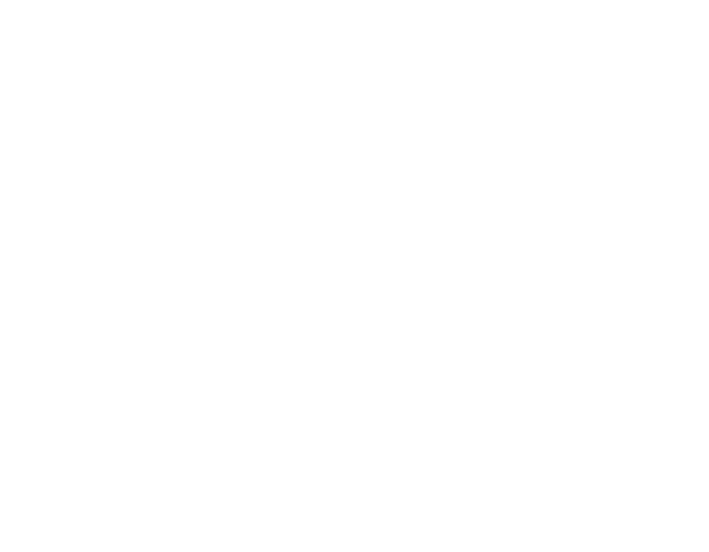
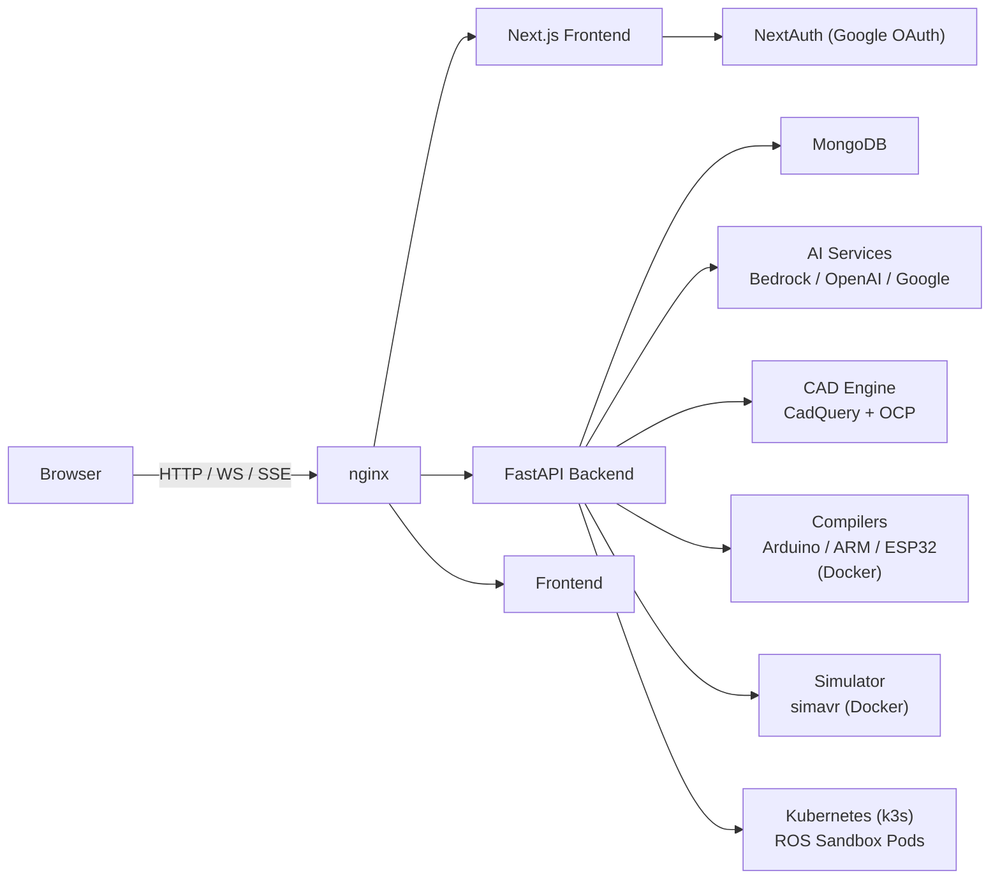
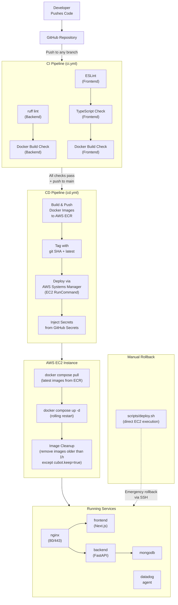

<p align="center">
  
</p>

<h1 align="center">CuBot IDE</h1>

<p align="center">
  A web-based IDE for embedded systems and robotics development.<br/>
  Code editor · Hardware simulator · AI assistant · CAD studio · Visual block programming · Fleet planner — all in one platform.
</p>

> [!NOTE]
> I'm running CuBot on my own, and keeping the backend online costs more than I can cover right now, so the live deployment is paused for the moment.
> If you'd like to see what it does, here's a short demo: https://lnkd.in/p/eVDMFRsW

---

## Architecture



---

## Deployment Workflow



---

## Running locally

```bash
docker compose up -d mongodb                                  # or any MongoDB on localhost:27017
docker compose --profile build-compilers build                # Arduino and ARM compiler images (linux/amd64)
cd backend && uv sync && MONGODB_URI=mongodb://localhost:27017 BEDROCK_MODEL_ID=<model> COMPILE_WORKDIR=/tmp/cubot-compile uv run uvicorn main:app --reload
cd frontend && npm install && npm run dev
docker compose up -d fleet-broker                             # Fleet Planner MQTT broker (TCP 1893, WebSocket 127.0.0.1:9011)
cd backend && MONGODB_URI=mongodb://localhost:27017 uv run python -m services.fleet.coordinator
```

The compiler images are built for `linux/amd64`: the AVR toolchain only ships x86-64 binaries, and Docker Desktop runs them under Rosetta on Apple Silicon. `COMPILE_WORKDIR` must be a writable directory (the default `/compile_tmp` is a container path).

The last two lines are only needed for Fleet projects. The fleet coordinator is a separate process next to the backend; with the defaults (`FLEET_MQTT_HOST=localhost`, `FLEET_MQTT_PORT=1893`, `FLEET_MQTT_WS_URL=ws://localhost:9011`) the backend, the coordinator and the browser all find the broker on localhost.

## Features

### Code Editor (IDE)

The IDE is built around Monaco Editor — the same engine that powers VS Code.

**File Management**
- VSCode-style file explorer with tree view and drag-and-drop
- Create, rename, and delete files and folders
- Multi-tab editing with unsaved change tracking
- Supports C, C++, `.ino`, Python, Markdown, JSON, and more
- Keyboard shortcuts mirroring VS Code defaults

**Project Types**
- **Embedded** — Arduino, ESP32, and TI ARM projects with hardware-specific toolchains
- **ROS** — Linux-based projects backed by Kubernetes sandbox pods

**Compilation**
- Compiler runs in an isolated Docker container per toolchain
- Supported targets: Arduino (avr-gcc), TI ARM (arm-none-eabi-gcc), ESP32 (xtensa)
- Compile output streams to an integrated terminal panel
- Errors are highlighted, explained by the AI, or handed to the AI to fix

**Serial Monitor**
- Connect to physical hardware over USB serial
- Configurable baud rate
- Send and receive raw UART data in real time

**Firmware Upload**
- Flash compiled `.hex` / `.bin` to a connected device
- Upload progress tracked step-by-step in a dialog

---

### AI Assistant

The assistant in the IDE side panel is a coding agent: it reads the project, edits files with tools, compiles, and fixes what breaks, while the panel shows every step as it happens. Details in [docs/ai-agent.md](docs/ai-agent.md).

**Modes**
- **Vibe** — The AI makes the change itself: reads the relevant files, edits them, runs the compiler, and iterates on errors (up to three rounds) before reporting back.
- **Plan** — The AI writes a numbered plan. You run the steps one at a time (or all at once); each step runs with the same tools as Vibe mode.

**What you see while it works**
- The answer streams token by token as rendered markdown, with a live activity list above it: *Reading main.cpp*, *Editing main.cpp (+4 −3)*, *Compiling project · Build passed*. Command and compiler output expands inline.
- A changed-files card per turn. Open any file in the editor, or **Revert** it (the previous content is kept on the message).
- **Fix with AI** on the compile dialog hands the errors straight to the agent.

**Conversations**
- Every project keeps as many chats as you like. `+` starts a new one, the clock lists past chats (auto-titled from the first message) with rename and delete. The IDE reopens the last one you used.

**Context**
- The open file is always attached; requests that name no file refer to it. Select code in the editor and click *Add to chat* to pin a range.
- Optional web search (Exa) for current library docs and datasheets.

**Agent tools**
`list_files`, `read_file`, `create_file`, `edit_file` (exact-span replace), `update_file`, `compile_project` (embedded targets), `execute_in_sandbox` (ROS projects), `search_web`.

**Providers**
- AWS Bedrock (default, configurable model ID; Claude and OpenAI-compatible models)

---

### CAD Studio

A natural language interface for generating 3D models using CadQuery — a Python-based parametric CAD library.

**Generation Modes**

| Mode | Description |
|------|-------------|
| Single-Shot | Fast generation for simple shapes — one prompt, one script |
| Planned | Multi-step decomposition for complex assemblies — breaks the design into parts, executes each with a reflect-and-fix loop |

**Planned Pipeline (Layered Architecture)**
1. `cad_planner.py` decomposes the request into named parts with dependencies
2. `cad_part_executor.py` generates and runs each part's CadQuery script in sequence
3. Each step streams progress over SSE — the UI renders a live plan panel
4. Failed parts trigger an automatic reflect-and-fix retry

**Output**
- Live 3D preview rendered from a base64-encoded STL
- Download the `.stl` file for use in any CAD tool or slicer
- View the generated CadQuery Python source code

---

### Visual Block Programming

A drag-and-drop node editor (powered by XYFlow) for programming robot arm motions without writing code.

**Available Block Types**

| Block | Description |
|-------|-------------|
| Start / End | Program entry and exit points |
| For Loop | Repeat a block sequence N times |
| While | Repeat while a condition holds |
| If / Else | Conditional branching |
| Move Position | Move arm to an (x, y, z) Cartesian target |
| Move Joint | Set individual joint angles directly |
| Get Position | Read current arm position into a variable |
| Delay | Pause execution for N milliseconds |

**3D Arm Visualization**
- Live Three.js rendering of the robot arm
- Updates in real time as the arm state changes over WebSocket
- Visualize the effect of each block before running on hardware

**Execution**
- Block programs are serialized and sent to the backend
- The backend converts them to executable code and dispatches to the arm
- Real-time status streamed back over `/ws/arm/status` WebSocket

**Inverse Kinematics**
- Built-in IK solver translates Cartesian targets to joint angles
- Used by Move Position blocks automatically

---

### Fleet Planner

A workspace for planning and coordinating a fleet of ground robots and drones. Details in [docs/fleet-planner.md](docs/fleet-planner.md).

**Scene**
- 2D or 3D grid environment with obstacles and floor presets, rendered in SVG or Three.js
- Robots, drones, tasks (priority, deadline, ground or aerial) and categories that restrict which vehicle can do which task

**Planning**
- Path planning with A*, Dijkstra, Theta*, RRT and RRT* (3D A* for drones), with obstacle clearance and an animation of the explored cells
- Greedy task assignment to the closest eligible vehicle, and per-vehicle task sequences

**Coordination**
- The fleet coordinator schedules tasks against their deadlines and dispatches routes as VDA 5050 orders (`uagv/v2/...`) to robots and `uav/v1/...` orders to drones over MQTT (Mosquitto)
- **Simulated** mode drives the fleet in the browser; **live** mode shows only what real vehicles report
- `sdk/cubot-sdk` connects real robots and drones: implement `get_state()` and `on_order()`, the SDK handles the protocol

---

### Simulator

Run compiled Arduino firmware in a browser-connected software emulator — no hardware required.

**How It Works**
1. Upload a compiled `.hex` file (output from the compile step)
2. The backend launches `simavr` inside Docker targeting ATmega328p
3. A WebSocket streams real-time pin state changes and serial output back to the browser

**Observable Outputs**
- Digital pin HIGH/LOW transitions with timestamps
- `Serial.print()` / `Serial.println()` output
- All events streamed as JSON over WebSocket

**Live Inputs**
- Virtual sensors feed the running sketch: an analog sensor sets the voltage on its pin (`analogRead` returns the matching 0–1023 value), a PIR drives its digital pin HIGH or LOW. Environment presets such as *Kitchen Fire* therefore change what the program sees.
- Each sensor card shows the pin voltage and the exact `analogRead` / `digitalRead` result, with a *How it reads* note (the part's transfer function, e.g. TMP36: 500 mV + 10 mV/°C) and a copyable code snippet to convert the reading back.
- A serial input line sends text to the sketch's `Serial`.
- Simulated time is throttled to wall-clock time, so `delay()` and `millis()` behave like on the board.

---

### ROS / Kubernetes Sandbox Integration

For ROS projects, CuBot IDE runs a ROS Humble pod per project on a Kubernetes cluster (k3s in production) and drives it through the `pods/exec` API — the same mechanism as `kubectl exec`.

**Workspace Lifecycle**
- Create a sandbox pod tied to a project (`ros-project-<project id>` in the `cubot-sandboxes` namespace)
- File sync in both directions (IDE files ↔ sandbox filesystem)
- Pod persists until explicitly deleted; a restarted backend reconnects to it

**Terminal Access**
- xterm.js terminal connected to an interactive shell in the pod
- Run ROS nodes, `colcon build`, `ros2 launch`, etc. from the browser
- Full Linux environment with ROS pre-installed

**File Sync**
- Push individual files or the entire project to the sandbox
- Pull changes made in the sandbox back into the IDE

---

### Custom Component Library

Define reusable sensors and actuators to use across projects.

- Specify component type (sensor or actuator), pins, and configurable properties
- Attach a custom icon and rendering script
- Simulate component behavior in isolation via the component simulation service
- Components appear as options in the wiring diagram tool

---

### Wiring Diagram Generator

Automatically generate circuit diagrams from component selections.

- Pick components from the library
- The backend generates an SVG showing physical wiring connections
- Export the diagram for documentation or hardware assembly

---

### Authentication

- Google OAuth via NextAuth.js
- JWT tokens verified by the FastAPI backend on every request
- Session state managed client-side, no cookies shared with the API

---

## Tech Stack

| Layer | Technologies |
|-------|--------------|
| **Frontend** | Next.js 16 (App Router), React 19, TypeScript 5 |
| **UI** | Shadcn/ui, Radix primitives, Tailwind CSS v4 |
| **Editor** | Monaco Editor |
| **3D / Graphics** | Three.js, React Three Fiber, WebGL (PixelSnow) |
| **Visual Programming** | XYFlow |
| **Terminal** | xterm.js with WebGL addon |
| **Backend** | FastAPI, uvicorn, Python 3.11+ |
| **Database** | MongoDB 7.0 (Motor async driver) |
| **AI / LLM** | AWS Bedrock, Google GenAI, OpenAI |
| **CAD** | CadQuery 2.4.0, OCP 7.7.2 |
| **Compilers** | Docker (avr-gcc, arm-none-eabi-gcc, xtensa) |
| **Simulation** | simavr (ATmega328p), Docker |
| **Sandboxes** | Kubernetes (k3s) pods |
| **Auth** | NextAuth.js, Google OAuth, JWT |
| **Observability** | Datadog APM, Logs, Tracing |
| **Infra** | Docker Compose, nginx, AWS EC2, AWS ECR |
| **CI/CD** | GitHub Actions |

---

## Project Structure

```
cubot-ide/
├── frontend/               # Next.js application
│   ├── app/                # App Router pages
│   │   ├── page.tsx        # Landing page
│   │   ├── dashboard/      # Project dashboard
│   │   ├── ide/            # Code editor
│   │   ├── cad/            # CAD studio
│   │   ├── blocks/         # Block editor
│   │   ├── fleet/          # Fleet Planner
│   │   └── simulator/      # Firmware simulator
│   ├── components/
│   │   ├── ide/            # Editor, chat, compile, serial, upload, terminal
│   │   ├── blocks/         # Block nodes, arm visualization
│   │   ├── cad/            # CAD chat, plan panel, STL viewer
│   │   └── ui/             # Shadcn primitives (40+ components)
│   ├── contexts/           # ProjectContext (global state)
│   ├── hooks/              # WebSocket hooks, navigation
│   └── lib/
│       ├── api/            # HTTP + WebSocket client layer
│       └── simulator/      # AVR simulation utilities
├── backend/                # FastAPI application
│   ├── routes/             # HTTP + WebSocket route handlers
│   ├── services/           # Business logic (AI, CAD, compile, IK, etc.)
│   ├── models/             # Pydantic data models
│   ├── schemas/            # Request / response validation
│   └── core/               # Config, database, auth
├── sdk/
│   └── cubot-sdk/          # Vehicle SDK for connecting robots and drones to the Fleet Planner
├── compilers/              # Compiler Docker image definitions
│   ├── arduino/
│   └── ti-arm/
├── scripts/
│   ├── deploy.sh           # Manual deploy / rollback helper
│   └── setup-k3s.sh        # One-time k3s install for ROS sandbox pods
├── k8s/                    # Sandbox namespace, RBAC, network policy
├── nginx/                  # Reverse proxy config
├── mosquitto/              # Fleet Planner MQTT broker config
├── .github/workflows/      # CI and CD pipelines
└── docker-compose.yml      # Service orchestration
```

---

## Environment Variables

| Variable | Description |
|----------|-------------|
| `DOMAIN` | Public domain (e.g. `ide.example.com`) |
| `NEXTAUTH_SECRET` | NextAuth signing secret |
| `GOOGLE_CLIENT_ID` | Google OAuth client ID |
| `GOOGLE_CLIENT_SECRET` | Google OAuth client secret |
| `MONGO_USER` / `MONGO_PASSWORD` | MongoDB credentials |
| `AWS_REGION` | AWS region for Bedrock and ECR |
| `AWS_ACCESS_KEY_ID` | AWS access key |
| `AWS_SECRET_ACCESS_KEY` | AWS secret key |
| `BEDROCK_MODEL_ID` | Bedrock model identifier |
| `KUBE_CONFIG_DIR` | Host directory with the backend kubeconfig (default `/opt/cubot/kube`, written by `scripts/setup-k3s.sh`) |
| `SANDBOX_NAMESPACE` / `SANDBOX_IMAGE` | Namespace and image for ROS sandbox pods (backend `.env`) |
| `SECRET_KEY` | FastAPI JWT signing key |
| `ALLOWED_ORIGINS` | CORS allowed origins |
| `FLEET_MQTT_HOST` / `FLEET_MQTT_PORT` | MQTT broker the fleet coordinator connects to (default `localhost:1893`) |
| `FLEET_MQTT_WS_URL` | Broker WebSocket URL handed to the browser (default `ws://localhost:9011`, `wss://${DOMAIN}/mqtt` in docker-compose) |
| `NEXT_PUBLIC_FLEET_MQTT_URL` | Frontend fallback broker WebSocket URL (build argument) |
| `DD_API_KEY` | Datadog API key |
| `DD_SITE` / `DD_ENV` / `DD_VERSION` | Datadog configuration |

---

## Running Locally

```bash
# Clone the repo
git clone https://github.com/your-org/cubot-ide.git
cd cubot-ide

# Copy and fill in environment variables
cp .env.example .env

# Start all services
docker compose up -d

# Frontend available at http://localhost:3000
# Backend API at http://localhost:8000
```

For development with hot reload:

```bash
# Backend
cd backend
pip install -e ".[dev]"
uvicorn main:app --reload

# Frontend
cd frontend
npm install
npm run dev
```

### ROS sandboxes locally

ROS projects need a Kubernetes cluster. Any local one works (Docker Desktop's built-in Kubernetes, kind, minikube). The backend uses your current `kubectl` context:

```bash
kubectl apply -f k8s/sandboxes.yaml
```

In production, `scripts/setup-k3s.sh` installs k3s on the EC2 host and writes a namespace-scoped kubeconfig that `docker-compose.yml` mounts into the backend container. The CD pipeline runs it on every deploy (it is idempotent). Keep port 6443 closed in the security group.
